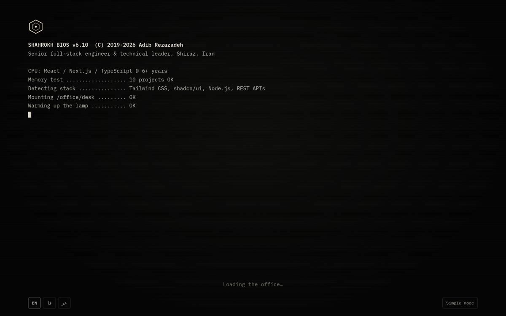
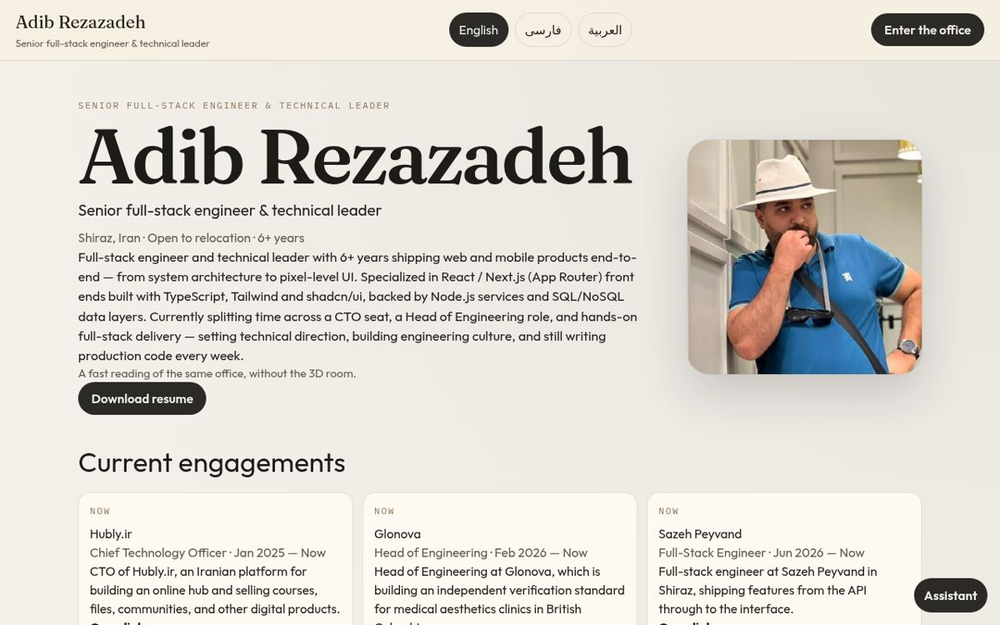
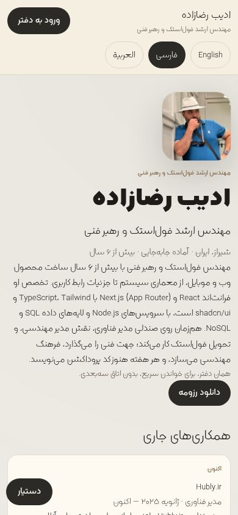

# Adib Rezazadeh — 3D portfolio

An interactive 3D office portfolio you can walk into, in **English, Persian, and Arabic** (RTL for fa/ar), with a fast no‑WebGL "simple mode" for phones. Open source under the MIT license, so you can fork it as a template for your own portfolio.

**Live demo: [adibrezazadeh.ir](https://adibrezazadeh.ir)**

| Boot screen | Simple mode (desktop) | Persian, mobile |
| --- | --- | --- |
|  |  |  |

## Stack

- [Next.js](https://nextjs.org) App Router + TypeScript
- [React Three Fiber](https://r3f.docs.pmnd.rs) / three.js for the room (`components/scene/OfficeCanvas.tsx`)
- Built-in i18n for `en`, `fa`, `ar` via the `app/[lang]/` route, with RTL layout for Persian and Arabic
- Web Audio for all sounds, CC0 models and textures from Poly Haven

## Use it as your own portfolio

1. **Fork** this repo (or click "Use this template") and clone it.
2. **Edit your content in `lib/profile.ts`.** Everything lives there, in all three languages:
   - `person`: name, localized names, email, phone, LinkedIn, GitHub, location, role line, summary
   - `stack`, `leadership`, `education`
   - `projects`: roles and work shown on the frames and in AdibOS
   - `ui`: every interface string, per language (`en`, `fa`, `ar`)
3. **Text built from that data**: `lib/resume.ts` (resume / downloadable text), `lib/terminal.ts` (terminal commands), `lib/assistant.ts` (desk assistant answers), `lib/seo.ts` and `lib/site.ts` (metadata, sitemap, JSON-LD).
4. **Images**: put your portrait at `public/me.jpg`, project images in `public/frames/`, logos in `public/marks/`. Remove Adib's.
5. **Fonts**: Emkan is a licensed third-party font, not covered by MIT. Delete `app/fonts/emkan/` and the `localFont` block in `app/layout.tsx`, and point `--font-rtl` in `app/globals.css` at `var(--font-vazir)` (Vazirmatn, OFL).
6. Drop a language by removing it from `LANGS` in `lib/types.ts` and its entries in `lib/profile.ts`.

## Deploy on Vercel

1. Push your fork to GitHub.
2. In Vercel, **Add New → Project**, import the repo. The Next.js preset needs no changes.
3. Optional environment variables: `NEXT_PUBLIC_SITE_URL` (your domain), `GOOGLE_SITE_VERIFICATION`, `BING_SITE_VERIFICATION`, and `ASSISTANT_API_KEY` / `ASSISTANT_API_URL` / `ASSISTANT_MODEL` for the optional assistant API.
4. Deploy, then add your custom domain under **Settings → Domains**.

## Credit

The code is MIT licensed, so you don't have to, but if you use this as a template, a small link back is appreciated: "Based on [Adib Rezazadeh's portfolio](https://github.com/adibrezazadeh/adibrezazadeh-resume)". A star or a message showing your version is welcome too. Inspired by [henryheffernan.com](https://henryheffernan.com).

## Run locally

```bash
npm install
npm run dev
```

Open [http://localhost:3000](http://localhost:3000).

```bash
npm run build
npm start
```

## How a visit goes

1. **Boot.** A BIOS-style screen types out the resume while the room loads, then asks for a click. The click also unlocks sound.
2. **Lights on.** The camera flies in along a curved path, the monitor light bar clicks on, the `</>` neon stutters to life, and the monitor powers up into AdibOS.
3. **Digital-twin desk.** Keys on the 3D keyboard press down as the visitor types, and the 3D mouse slides and clicks with their real one. Every key, click, and whoosh is synthesized with the Web Audio API (`lib/sound.ts`), so there are no audio files.
4. **Your sky.** The window shows dawn, day, dusk, or night from the visitor's local clock. By day the sun casts the window frame and swaying leaves across the desk; after dark a warm pendant carries the room. The wall clock shows the visitor's time.
5. **A crisp screen.** From the room the monitor shows a painted picture of the desktop. Once the camera lands, the live AdibOS appears as a flat overlay exactly over the screen, drawn at full resolution with CSS zoom. Every place has a URL (`#monitor`, `#project=hubly`, …), so Back steps out instead of leaving the site.

## Performance

Measured on an Intel UHD 730 (integrated) at 1440×900, production build: about 30 fps in the room and 90+ toward the gallery wall, with the boot screen ready in about 7 seconds.

- Shadows are rendered while the scene warms up behind the boot screen, then frozen; only the sun casts them.
- The room's surfaces use colour and roughness maps only; the reflection environment is procedural.
- Resolution adapts once, during boot, and never drops below 85% so text and edges stay sharp. Post-processing is what gives way first on weak GPUs.
- Click targets are never drawn, the keyboard is one instanced mesh, and textures and shaders are uploaded before the visitor clicks in.

## What is in the room

- **Monitor** — a thin-bezel display running AdibOS: project folders, a resume you can read or download, and a terminal (`help`, `whoami`, `projects`, `contact`, plus `skills`, `education`, `open`, `resume`, `clear`).
- **Phone on a stand** — email, phone, LinkedIn, GitHub.
- **Frames** — roles and selected work, with the public links that exist.
- **Shelves and sideboard** — the stack and leadership list from the resume.
- **Desk assistant** — answers in the language you picked, from local notes. It does not call a paid API unless you opt in.

Facts come from Adib's resume and the projects' public sites. Nothing else is filled in.

Put a square portrait at `public/me.jpg` and it appears in AdibOS's About window, at the top of simple mode, and in a frame on the shelf. Without the file, nothing is requested.

The room uses CC0 models and textures from [Poly Haven](https://polyhaven.com), compressed for the web; the modern furniture and devices are modeled in code. See `public/textures/CREDITS.txt`. Persian and Arabic are set in Emkan (FontIran), a licensed third-party font that is **not** covered by the MIT license and may not be redistributed. Forks should replace it with [Vazirmatn](https://github.com/rastikerdar/vazirmatn) (OFL), which is already loaded as the fallback.

## Optional assistant API

Leave these unset and the assistant stays on local notes. If both are set, only questions the notes do not match are sent to an OpenAI-compatible chat endpoint. The key stays on the server.

```bash
ASSISTANT_API_KEY=
ASSISTANT_API_URL=https://api.openai.com/v1/chat/completions
ASSISTANT_MODEL=gpt-4o-mini
NEXT_PUBLIC_SITE_URL=https://your-domain.example
GOOGLE_SITE_VERIFICATION=   # Search Console "HTML tag" code
BING_SITE_VERIFICATION=     # Bing Webmaster Tools msvalidate.01 code
```

## Search and AI answer engines

`/sitemap.xml`, `/robots.txt`, and `/llms.txt` are generated from `lib/profile.ts`. Each language page ships `ProfilePage` + `Person` JSON-LD and a server-rendered, visually hidden copy of the resume, so crawlers that do not run JavaScript still read the full text.

## Deploy

The app is a Next.js App Router project and deploys on Vercel with no extra services. `npm run build` is the production build.

## License

[MIT](LICENSE) © 2026 Adib Rezazadeh. The Emkan font, personal content, and photos are excluded; see [LICENSE](LICENSE).
